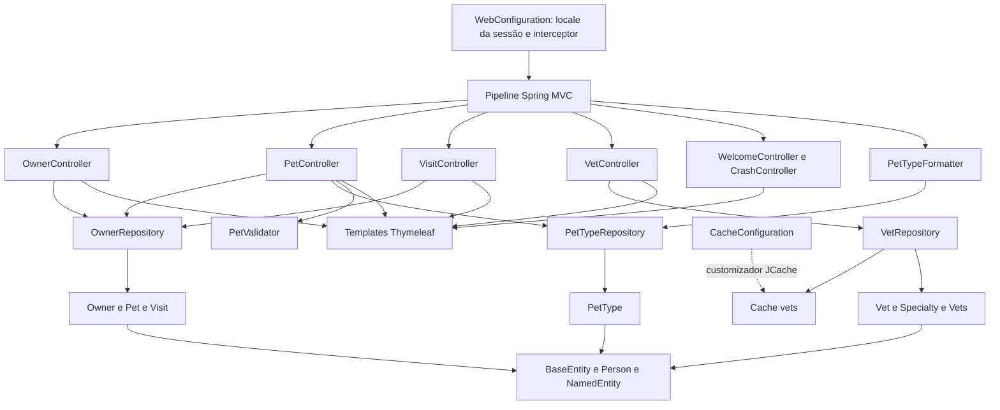

# C4 — Componentes

🟢 CONFIRMADO — Dependências de chamadas, herança e configuração extraídas dos imports, injeções e anotações. Model é compartilhado; system fornece infraestrutura transversal, não um serviço remoto.

🟢 CONFIRMADO — PetClinicApplication inicia o contexto e importa PetClinicRuntimeHints. Hints referenciam BaseEntity, Person e Vet para serialização. 🔴 LACUNA — Ativação concreta de JCache e conversores HTTP de XML não foi executada; seta pontilhada representa customização declarada, não confirmação de provedor ativo.
