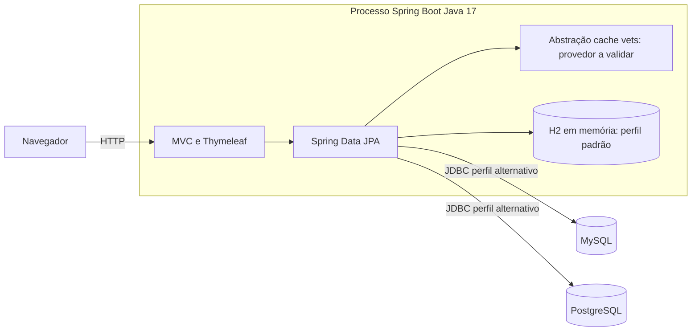

# C4 — Containers

🟢 CONFIRMADO — Um executável Spring Boot atende HTML e dados; não há frontend SPA independente. Os caches e H2 são bibliotecas/armazenamento no processo, não containers de implantação separados. Provedor de cache efetivo permanece 🔴 LACUNA.

🟢 CONFIRMADO — Processos locais usam Maven/Gradle; Kubernetes fornece app e PostgreSQL, enquanto Compose só declara bancos. Não há Redis, mensageria, serviço de autenticação ou armazenamento de objetos identificado no escopo.
