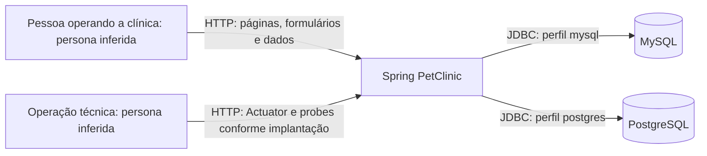

# C4 — Contexto

🟢 CONFIRMADO — Sistema e bancos derivados dos manifests/configurações. 🟡 INFERIDO — Persona de operação da clínica; não há papel autenticado implementado. MySQL e PostgreSQL são alternativas, não dependências simultâneas. H2 pertence ao processo da aplicação.

Fontes: README.md, docker-compose.yml, k8s/*.yml, application*.properties e controllers. Sem integração de negócio externa adicional identificada. Persona responsável pelo animal não é conta de usuário no sistema.
