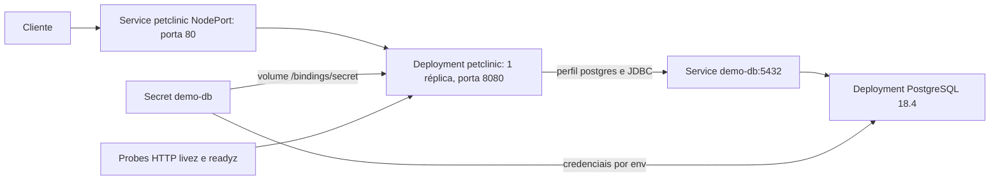

# Implantação e operação

## Direção de implantação da reescrita

🟢 O destino é **Next.js em monorepo Nx**, com PostgreSQL e Kubernetes; Docker local permanece preferência condicional. Ver [TARGET-STACK-01](validated-decisions.md). Build do workspace, empacotamento da aplicação, configuração de runtime, conexão PostgreSQL e probes deverão ser planejados para essa stack. Comandos Maven/Gradle, imagem Java e bindings Spring descritos abaixo são evidência do legado, não instruções de implantação da reescrita. Versões e pipeline do destino ainda não foram definidos.

## Validação posterior do usuário

🟢 As 14 respostas foram processadas em [decisões validadas](validated-decisions.md). Destino: PostgreSQL, rede local, fuso America/Sao_Paulo, português/inglês, ordem alfabética de veterinários e erro genérico; migração de dados históricos dispensada. Kubernetes é alvo prioritário e Docker local preferência condicional. Esses requisitos/contextos não alteram o retrato do legado abaixo nem provam runtime. Sem política de cache não significa removê-lo; sem contrato de erro não define status automaticamente.

🟢 CONFIRMADO — Descrição estática de README, docker-compose.yml, k8s/*.yml e .github/workflows/*.yml. Nenhum comando desta página foi executado pela análise.

## Desenvolvimento

- 🟢 CONFIRMADO — JDK 17, Maven Wrapper 3.9.16 ou Gradle Wrapper 9.5.1. Inicialização documentada: ./mvnw spring-boot:run ou ./gradlew bootRun; README usa porta 8080.
- 🟢 CONFIRMADO — H2 é padrão; perfil mysql ou postgres muda database e datasource. URLs e credenciais podem ser sobrescritas pelas variáveis MYSQL_URL/USER/PASS ou POSTGRES_URL/USER/PASS declaradas nos arquivos de propriedades.
- 🟢 CONFIRMADO — Compose publica MySQL 9.7 em 3306 e PostgreSQL 18.4 em 5432. Não declara serviço da aplicação. MySQL referencia bind mount ./conf.d; existência/conteúdo dessa pasta não foi comprovada no inventário.
- 🟢 CONFIRMADO — Sem Dockerfile de aplicação na raiz; README orienta imagem por ./mvnw spring-boot:build-image. Existe `.devcontainer/Dockerfile`, referenciado por `.gitpod.yml` para desenvolvimento, enquanto `.devcontainer/devcontainer.json` usa imagem/features próprias (Java 21 Oracle). Não confundir com build Java 17 da aplicação. [Revisão estática: escopo corrigido.] Não há evidência de que a imagem dsyer/petclinic do manifesto corresponda exatamente a este HEAD.

## Kubernetes

🟢 CONFIRMADO — Aplicação usa imagem dsyer/petclinic sem tag explícita; SPRING_PROFILES_ACTIVE=postgres, SERVICE_BINDING_ROOT=/bindings e health probes adicionais por SPRING_APPLICATION_JSON. Volume de secret é readOnly. PostgreSQL recebe usuário/senha/database por referências ao Secret. Não há PVC, ingress, resource requests/limits ou NetworkPolicy declarados nesses dois manifests.

🔴 LACUNA — Provar que a imagem resolve service bindings e aplica as credenciais: a configuração Java/build local não basta para confirmar comportamento da imagem remota. Sem executar cluster não se confirma a conexão, as probes ou a proteção de endpoints.

## CI/CD

| Workflow | Gatilho | Ações declaradas |
|---|---|---|
| maven-build.yml | push/PR em main | Java 17, ./mvnw -B verify |
| gradle-build.yml | push/PR em main | Java 17, setup Gradle, ./gradlew build |
| deploy-and-test-cluster.yml | push/PR em main com paths k8s/** | Kind, kubectl apply -f k8s/, espera de pods com timeout 180s |

🟢 CONFIRMADO — Workflow de cluster não constrói imagem a partir do checkout e não declara teste funcional HTTP; aguarda prontidão dos pods. Maven e Gradle são pipelines distintos. Perfil CSS Maven pode escrever petclinic.css no código fonte; por isso não foi executado nesta análise.

## Persistência e observabilidade

🟢 CONFIRMADO — H2 schema inicia com DROP TABLE; dados locais de exemplo não são persistência de produção. Perfis MySQL/PostgreSQL usam SQL init always. Estatísticas são habilitadas na configuração JCache criada, sem provar ativação do provedor. Actuator seleciona todos os endpoints para exposição. Não há limites de cache nem fuso explícitos encontrados.

🟡 INFERIDO — Sem volume de dados declarado, substituição do pod PostgreSQL pode perder dados. Manifests e credenciais são exemplos versionados; políticas reais de operação, backup, disponibilidade, TLS e controle de acesso são 🔴 LACUNAS. Nenhum SLA foi inferido.
