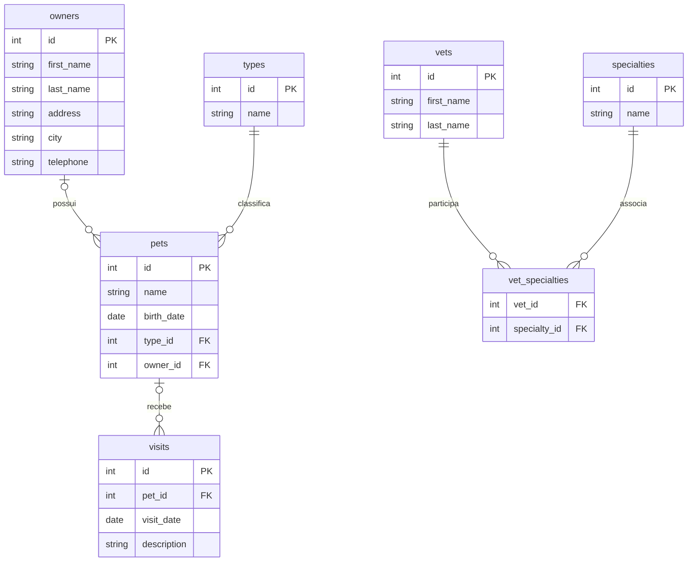

# ERD completo

🟢 CONFIRMADO — Tabelas e relações extraídas dos três schema.sql e entidades JPA. Diagrama mostra obrigatoriedade das FKs no SQL: tipo de animal obrigatório; responsável do animal e animal da visita nullable. A interface normalmente exige os vínculos via rotas. Tipos string abaixo abstraem VARCHAR/TEXT, cujas diferenças estão no dicionário.

🟢 CONFIRMADO — BaseEntity, Person e NamedEntity são superclasses mapeadas, não tabelas. Vets é envelope sem tabela. A tabela vet_specialties não tem entidade Java própria. MySQL/PostgreSQL declaram unicidade do par de FKs, H2 não. Nenhum campo status, veterinário responsável pela visita, duração ou preço foi localizado.

🟢 CONFIRMADO — Unicidade de nome do animal é por responsável, com diferenças entre perfis: H2 VARCHAR_IGNORECASE; PostgreSQL índice unique_owner_pet_name(owner_id,LOWER(name)); MySQL UNIQUE(owner_id,name), dependente de collation. 🔴 LACUNA — Não inferir equivalência completa do MySQL sem validar ambiente.
