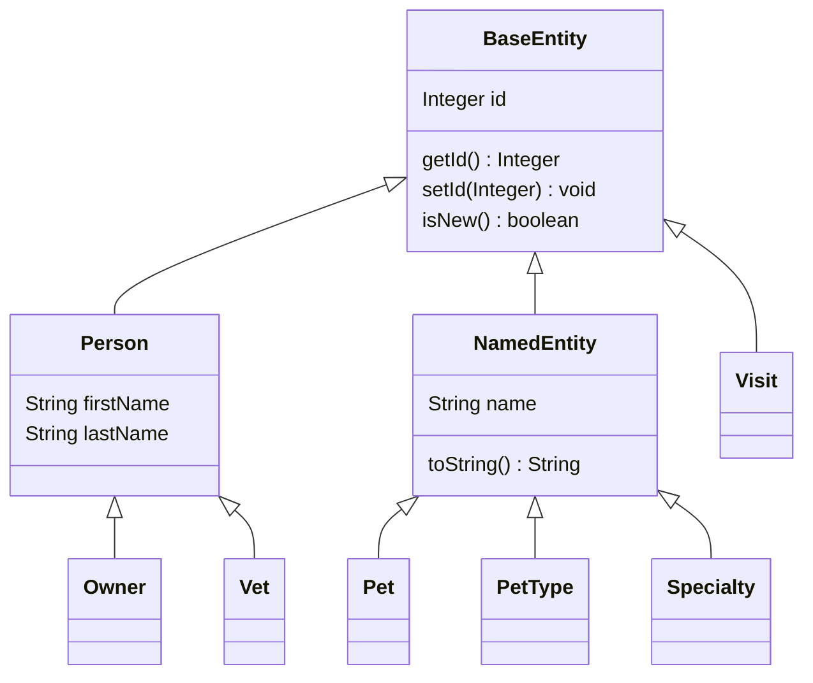

# Modelo compartilhado — Design Técnico

## Validação do usuário — escopo de destino

🟢 Decisões confirmadas pelo usuário, sem alteração do legado. Este bloco define a intenção de destino; seções de código/testes abaixo são o retrato extraído. Pendências de produto já respondidas não devem ser reabertas por textos históricos; apenas os residuais continuam em aberto.

- 🟢 **D-02:** Manter somente PostgreSQL. Escopo de banco do destino é PostgreSQL; H2/MySQL permanecem evidência histórica, não obrigação futura. Preservar a regra extraída de unicidade por responsável sem assumir necessidade de equivalência MySQL.
- 🟢 **VET-INV-01:** Não é necessário preservar dados. Dispensada migração/preservação de dados históricos no destino. Tarefas de migração de domínio deixam de ser obrigatórias; permite planejamento de instalação nova, sem autorização de exclusão de base existente.

🔴 Refinamentos e evidência técnica não executada: ver [registro de decisões](../validated-decisions.md) e [lacunas finais](../gaps.md). Nenhum requisito novo foi implementado.

🟢 CONFIRMADO — Contratos do pacote src/main/java/org/springframework/samples/petclinic/model/, cobrindo MOD-RF-01 a MOD-RF-04 de [requirements.md](requirements.md). Não há endpoint, repository ou template próprio nesta unit. Leitura estática; validação, persistência e serialização não foram executadas nesta etapa.

## Interface

| Símbolo | Entrada | Retorno | Efeito observado |
|---|---|---|---|
| 🟢 BaseEntity.getId | nenhum | Integer | Lê id |
| 🟢 BaseEntity.setId | Integer id | void | Atribui diretamente, inclusive null, zero ou negativo |
| 🟢 BaseEntity.isNew | nenhum | boolean | Retorna id == null, sem consulta ao banco |
| 🟢 NamedEntity.getName | nenhum | String | Lê name |
| 🟢 NamedEntity.setName | String name | void | Atribui sem normalização/validação imperativa |
| 🟢 NamedEntity.toString | nenhum | String | Retorna getName quando não null; senão literal <null> |
| 🟢 Person.getFirstName / getLastName | nenhum | String | Leem respectivos campos |
| 🟢 Person.setFirstName / setLastName | String | void | Atribuem diretamente, sem trim |

🟢 CONFIRMADO — As classes são públicas, não abstract, sem construtores explícitos no código; campos começam null. Person e NamedEntity estendem BaseEntity separadamente. Nenhum setter lança erro próprio por dado inválido; validação depende da invocação de Bean Validation no contexto consumidor.

## Fluxo Principal

### 1. Identidade e estado técnico — MOD-RF-01

1. 🟢 Construção de BaseEntity inicia id null; getId devolve null e isNew verdadeiro.
2. 🟢 setId(x) armazena x sem verificação de positividade/existência. Para qualquer Integer não null, isNew é falso, mesmo que nenhum registro correspondente exista.
3. 🟢 setId(null) volta a produzir isNew verdadeiro. Essa mutabilidade do objeto não significa apagar registro do banco.
4. 🟢 @Id e @GeneratedValue(strategy=IDENTITY) declaram geração de identidade na persistência. Atribuição efetiva, transações e rejeição de IDs dependem de ORM/schema e não são feitas pelo método isNew.

🟢 CONFIRMADO — Fonte: BaseEntity.java. Critérios MOD-CA-01/02/03. MOD-INV-01 permanece investigação de persistência/compatibilidade, não fluxo local de rejeição.

### 2. Nome e representação textual — MOD-RF-02

1. 🟢 setName armazena exatamente a String recebida e getName a retorna.
2. 🟢 @NotBlank declara restrição; a atribuição pode ocorrer antes de um validador rejeitar o objeto.
3. 🟢 toString chama getName: se não null retorna o conteúdo, incluindo vazio/whitespace; apenas null vira <null>.
4. 🟢 NamedEntity não declara Size ou comprimento específico de Column. Limites específicos vêm dos consumidores e schemas; não aplicar o limite de PetValidator a Specialty/PetType por inferência.

🟢 CONFIRMADO — Fonte: NamedEntity.java; critérios MOD-CA-04/05/06. O fallback textual não torna name null válido para Bean Validation e não é payload JSON/XML de erro.

### 3. Dados de pessoa e validação — MOD-RF-03

1. 🟢 Person armazena firstName/lastName em campos independentes, ambos @Column(length=30), @Size(max=30), @NotBlank.
2. 🟢 Getters/setters só leem/atribuem; não compõem nome completo nem normalizam espaços.
3. 🟢 Quando Bean Validation é invocado, restrições são avaliadas nas propriedades. Não existe método validate próprio em Person.
4. 🟢 ValidatorTests cria LocalValidatorFactoryBean, fixa Locale.ENGLISH e espera uma violação em firstName ou lastName vazio, com mensagem must not be blank. A suite não foi executada e não cobre todos os limites.

🟢 CONFIRMADO — Fontes: Person.java e src/test/java/org/springframework/samples/petclinic/model/ValidatorTests.java. Critérios MOD-CA-07/08/09.

### 4. Herança e consumo — MOD-RF-04

🟢 CONFIRMADO — BaseEntity, Person e NamedEntity são MappedSuperclass; suas propriedades são herdadas pelas entidades, sem tabelas base próprias nos schemas. Owner/Vet usam nomes de Person; Pet/PetType/Specialty usam name de NamedEntity; Visit herda diretamente BaseEntity. Fonte: três classes base e declarações extends dos seis consumidores. MOD-CA-10 descreve essa estrutura, não uma execução de migração.

## Fluxos Alternativos

| Condição | Comportamento confirmado | Limite |
|---|---|---|
| 🟢 ID zero/negativo | Armazenado e isNew falso | Não comprova existência/aceitação pelo banco |
| 🟢 ID substituído por null | Estado em memória muda para novo | Não é operação delete nem transição de negócio persistida |
| 🟢 Nome null | Getter null; NamedEntity.toString literal <null> | Bean Validation pode rejeitar ao ser invocado |
| 🟢 Nome vazio/whitespace | Setter preserva; toString retorna conteúdo não null | Não substituir automaticamente por fallback/trim |
| 🟢 Nome de pessoa acima de 30 | Setter preserva valor; Size declara invalidade | Não lança exceção própria na atribuição |
| 🟢 Validação não invocada pelo consumidor | Nenhum mecanismo de validação imperativa nessas classes | Ativação no ORM/MVC depende do contexto; não é garantia universal |

## Dependências

- 🟢 **Jakarta Persistence:** Id, GeneratedValue, Column, MappedSuperclass. As anotações descrevem mapeamento; SQL próprio e ddl-auto=none estão na configuração global.
- 🟢 **Jakarta Validation:** NotBlank e Size; infraestrutura de validação vive no framework/consumidores, não nessas classes.
- 🟢 **java.io.Serializable:** implementado por BaseEntity; herdado pelos consumidores. Não há serialVersionUID explícito.
- 🟢 **Units consumidoras:** responsáveis e veterinários dependem desta unit por herança. O pacote model não importa owner/vet/system nem chama repositórios.
- 🟢 **Inicialização nativa:** PetClinicRuntimeHints, fora desta unit, registra withJavaSerialization(true) para BaseEntity, Person e Vet. Não registra NamedEntity explicitamente nesse conjunto; isso não prova falha nativa, que exige execução.

## Decisões de Design Identificadas

| Decisão observada | Evidência | Confiança |
|---|---|---|
| Identidade comum em superclasse | BaseEntity e cadeia de extends | 🟢 CONFIRMADO |
| isNew por presença de ID | Expressão id == null | 🟢 CONFIRMADO; não consulta persistência |
| Superclasses mapeadas em vez de entidades base | MappedSuperclass nas três classes | 🟢 CONFIRMADO |
| Validação declarativa sem normalização nos setters | Anotações e acessores diretos | 🟢 CONFIRMADO |
| Fallback textual apenas para null | NamedEntity.toString | 🟢 CONFIRMADO |
| Ausência de igualdade/versão otimista próprias | Sem equals/hashCode/Version nas classes lidas | 🟢 CONFIRMADO no escopo; 🟡 consequências dependem do consumidor |

## Estado Interno

| Classe / campo | Tipo / valor inicial | Declarações |
|---|---|---|
| 🟢 BaseEntity.id | Integer / null | Id, GeneratedValue IDENTITY |
| 🟢 NamedEntity.name | String / null | Column, NotBlank |
| 🟢 Person.firstName | String / null | Column length 30, Size max 30, NotBlank |
| 🟢 Person.lastName | String / null | Column length 30, Size max 30, NotBlank |

🟢 CONFIRMADO — Não há coleção, cache, estado global, campo status, timestamp de auditoria ou token Version nessas classes. Serializable é capacidade técnica, não serialização automática em toda requisição. A igualdade herdada não é redefinida por ID/nome no código analisado; consumidores que usam Set/List têm regras próprias documentadas em outras units.

🟢 CONFIRMADO — @Column não declara nullable=false nesses campos, e os schemas reais variam entre VARCHAR/TEXT, inclusive aceitando null onde a validação exige texto. Não inferir DDL de produção apenas de anotações Java. Ver [dicionário de dados](../data-dictionary.md).

## Observabilidade

🟢 CONFIRMADO — Não há logger, métricas, emissão de eventos ou captura local de erro nas três classes. A avaliação de restrições produz violações no validador chamador; não gera resposta HTTP por esta unit.

🟢 CONFIRMADO — VetTests.serialization usa SerializationUtils para serializar/deserializar Vet e comparar firstName/lastName/id. É expectativa de teste sem especialidades configuradas, não prova de compatibilidade binária entre releases ou de JSON/XML. Testes não executados nesta etapa.

## Riscos e Lacunas

- 🔴 **MOD-INV-01:** geração/reatribuição de IDs com persistência e compatibilidade de objetos serializados antigos exigem caracterização no destino; não há migração escolhida ou política entre versões definida.
- 🟡 Alterar igualdade por ID/nome pode mudar deduplicação de collections em responsáveis/veterinários; não adicionar equals/hashCode como detalhe neutro da reimplementação.
- 🟡 Adicionar Version ou validação imperativa/trim nos setters muda contratos e deve ser decisão separada, não preenchimento automático de lacuna.
- 🟢 Comprimento de String não estabelece contagem de grafemas visuais; não extrapolar regras de apresentação de Unicode a partir de Size/length.
- 🔴 Nulabilidade/limites efetivos de banco e suporte nativo/serialização precisam de execução por perfil/artefato se forem necessários ao destino.

## Rastreabilidade

🟢 CONFIRMADO — Fontes próprias: src/main/java/org/springframework/samples/petclinic/model/BaseEntity.java, NamedEntity.java, Person.java e package-info.java. Consumidores: owner/Owner.java, Pet.java, PetType.java, Visit.java e vet/Vet.java, Specialty.java no mesmo pacote raiz petclinic.

🟢 CONFIRMADO — MOD-RF-01 → fluxo 1/MOD-CA-01–03; MOD-RF-02 → fluxo 2/MOD-CA-04–06; MOD-RF-03 → fluxo 3/MOD-CA-07–09; MOD-RF-04 → fluxo 4/MOD-CA-10. M01–M06 em requirements.md identificam fontes compartilhadas e testes.

🟢 CONFIRMADO — Ver [análise técnica](../code-analysis.md), [ERD](../erd-complete.md), [fluxo modelo](../flowcharts/model.md) e [matriz de impacto](../traceability/spec-impact-matrix.md). Não há contrato HTTP próprio a acrescentar; o plano atual não prevê contracts.md para modelo.
