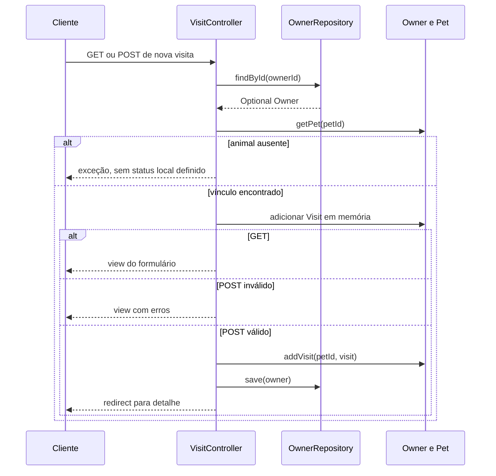

# Responsáveis, animais e visitas — Design Técnico

## Validação do usuário — escopo de destino

🟢 Decisões confirmadas pelo usuário, sem alteração do legado. Este bloco define a intenção de destino; seções de código/testes abaixo são o retrato extraído. Pendências de produto já respondidas não devem ser reabertas por textos históricos; apenas os residuais continuam em aberto.

- 🟢 **D-01:** Visita sempre deve conter data futura. Requisito desejado confirmado; rejeitar data null/vazia e hoje/passado no destino. Padrão amanhã pode continuar na abertura, sem dispensar validação. Omissão que mantém o default não comprova confirmação explícita de data pelo usuário.
- 🟢 **D-02:** Manter somente PostgreSQL. Escopo de banco do destino é PostgreSQL; H2/MySQL permanecem evidência histórica, não obrigação futura. Preservar a regra extraída de unicidade por responsável sem assumir necessidade de equivalência MySQL.
- 🟢 **D-03:** Sistema somente em rede local. Contexto de uso em rede local informado pelo usuário. Não inferir autenticação, papéis, ausência de ameaças ou configuração real de ACL/proxy. Aplicar contexto às operações de todas as units.
- 🟢 **D-05:** São Paulo, Brasil. Adotar America/Sao_Paulo como identificador técnico correspondente ao local informado. Não usar offset UTC fixo nem inferir que JVM atual já está nesse fuso.
- 🟢 **D-06:** Não há contrato de erro conhecido. Confirmada ausência de contrato conhecido pelo usuário. Não impor 404/409 ou body específico como regra existente; definir contrato na evolução se necessário.
- 🟢 **RESP-D-07:** Não preservar filtro ao trocar páginas. Resposta Não interpretada para a primeira pergunta direta: filtro não precisa permanecer ativo. Comportamento atual dos links pode ser preservado, sem correção automática.
- 🟢 **VET-INV-01:** Não é necessário preservar dados. Dispensada migração/preservação de dados históricos no destino. Tarefas de migração de domínio deixam de ser obrigatórias; permite planejamento de instalação nova, sem autorização de exclusão de base existente.
- 🟢 **SIS-D-02:** Português e inglês. Idiomas requeridos do destino: português e inglês. Outros bundles do legado não são obrigatórios por esta resposta; não removidos. Default inglês do código fica como referência atual, sem escolha nova de default.
- 🟢 **SIS-D-03:** Página genérica de erro sem expor informações. Requisito desejado confirmado: página genérica sem detalhes internos de exceção/configuração. Override ALWAYS e mensagem demonstrativa dos testes são históricos, não alvo de implantação.

🔴 Refinamentos e evidência técnica não executada: ver [registro de decisões](../validated-decisions.md) e [lacunas finais](../gaps.md). Nenhum requisito novo foi implementado.

🟢 CONFIRMADO — Design extraído do pacote `src/main/java/org/springframework/samples/petclinic/owner/` e dos templates indicados abaixo. Refere-se aos requisitos RESP-RF-01 a RESP-RF-09 de [requirements.md](requirements.md). Análise estática, sem execução da aplicação ou testes; efeitos de infraestrutura não comprovados permanecem 🔴 LACUNAS.

## Interface

### Contratos HTTP

🟢 CONFIRMADO — Os handlers usam Spring MVC e binding de objetos de formulário, retornando nomes de view, redirect ou ModelAndView. Não são endpoints de CRUD JSON. POSTs dos templates usam método post sem action explícito, submetendo à URL corrente. Parâmetros de rota são inteiros; dados pessoais, nome de animal, tipo e descrição são texto; datas usam LocalDate com yyyy-MM-dd.

🟡 INFERIDO — Renderização normal corresponde a 200 e redirect a 3xx conforme o pipeline MVC; os métodos não fixam códigos com ResponseEntity/@ResponseStatus. O status final de exceções, conversão de parâmetros ou falha de renderização é 🔴 LACUNA para caracterização em execução. Não presumir 201/400/404/409 como contratos de negócio.

| Método | Caminho | Entrada de aplicação | Saída do handler | Status |
|---|---|---|---|---|
| 🟢 GET | /owners/new | sem ownerId; Owner novo no model | owners/createOrUpdateOwnerForm | 🟡 200 normal |
| 🟢 POST | /owners/new | firstName, lastName, address, city, telephone | formulário em erro; redirect:/owners/{id gerado} em sucesso | 🟡 200 ou 3xx |
| 🟢 GET | /owners/find | Owner novo no model | owners/findOwners | 🟡 200 normal |
| 🟢 GET | /owners | lastName opcional, page:int padrão 1 | busca, lista ou redirect conforme resultados/faixa | 🟡 200 ou 3xx |
| 🟢 GET | /owners/{ownerId} | ownerId:int | ModelAndView owners/ownerDetails com Owner | 🟡 200 normal; 🔴 ausência |
| 🟢 GET | /owners/{ownerId}/edit | ownerId:int | owners/createOrUpdateOwnerForm com Owner carregado | 🟡 200 normal; 🔴 ausência |
| 🟢 POST | /owners/{ownerId}/edit | ownerId:int e campos pessoais | formulário, redirect de edição por mismatch, ou redirect de detalhe | 🟡 200 ou 3xx; 🔴 ausência |
| 🟢 GET | /owners/{ownerId}/pets/new | ownerId:int | pets/createOrUpdatePetForm; model com owner, pet e types | 🟡 200 normal; 🔴 ausência |
| 🟢 POST | /owners/{ownerId}/pets/new | name, birthDate, type e ownerId da rota | formulário em erro; redirect:/owners/{ownerId} em sucesso | 🟡 200 ou 3xx; 🔴 exceções |
| 🟢 GET | /owners/{ownerId}/pets/{petId}/edit | ownerId:int, petId:Integer | pets/createOrUpdatePetForm com pet buscado no owner | 🟡 200 normal; 🔴 pet ausente |
| 🟢 POST | /owners/{ownerId}/pets/{petId}/edit | rota e name, birthDate, type | formulário em erro; redirect:/owners/{ownerId} em sucesso | 🟡 200 ou 3xx; 🔴 exceções |
| 🟢 GET | /owners/{ownerId}/pets/{petId}/visits/new | ownerId:int, petId:int | pets/createOrUpdateVisitForm; model owner, pet, visit, minVisitDate | 🟡 200 normal; 🔴 ausência |
| 🟢 POST | /owners/{ownerId}/pets/{petId}/visits/new | rota e date, description | formulário em erro; redirect:/owners/{ownerId} em sucesso | 🟡 200 ou 3xx; 🔴 exceções |

🟢 CONFIRMADO — Evidências: OwnerController.java:64/72/77/89/94/148/153/178, PetController.java:48/100/107/139/144 e VisitController.java:63/90/97. Caminhos Java nesta seção são relativos ao pacote owner. O hidden id do formulário de Pet é ignorado pelo binder; o hidden petId do formulário de visita não é a fonte do parâmetro @PathVariable do handler.

### Interface entre componentes

🟢 CONFIRMADO — Repositórios recebem entidades JPA, não DTOs separados. Métodos abaixo descrevem as assinaturas e responsabilidades relevantes; getters/setters simples estão indexados em `.reversa/context/modules.json`.

| Símbolo | Assinatura de entrada | Retorno e efeito |
|---|---|---|
| 🟢 OwnerRepository.findByLastNameStartingWith | String lastName, Pageable pageable | Page<Owner>; consulta por prefixo |
| 🟢 OwnerRepository.findById | Integer id | Optional<Owner> |
| 🟢 OwnerRepository.save / saveAndFlush | Owner entity (métodos herdados de JpaRepository) | entidade salva; flush explícito nos fluxos de Pet |
| 🟢 PetTypeRepository.findPetTypes | sem parâmetros | List<PetType>, JPQL SELECT ptype FROM PetType ptype ORDER BY ptype.name |
| 🟢 PetTypeFormatter.parse / print | String text, Locale locale / PetType petType, Locale locale | PetType ou ParseException / String nome ou literal <null> |
| 🟢 PetValidator.validate / supports | Object obj, Errors errors / Class<?> clazz | void com rejeições / boolean de compatibilidade com Pet |
| 🟢 Owner.addPet | Pet pet | void, adição com deduplicação de instância/ID |
| 🟢 Owner.getPet | Integer id ou String name, boolean ignoreNew | Pet ou null; overload String delega com false |
| 🟢 Owner.addVisit | Integer petId, Visit visit | void; asserts e adição ao pet encontrado |
| 🟢 Pet.addVisit | Visit visit | void; adiciona ao Set de visitas |

## Fluxo Principal

### 1. Carregar model e realizar binding — RESP-RF-09

1. 🟢 OwnerController.findOwner cria Owner se a rota não tem ownerId; caso contrário, consulta o repositório e lança IllegalArgumentException se ausente. Os métodos subsequentes recebem o objeto pelo model (OwnerController.java:65).
2. 🟢 PetController carrega types via repository, owner pela rota e pet: novo quando petId é ausente; para edição consulta owner e chama owner.getPet(petId). Essa busca pode retornar null sem rejeição explícita local (PetController.java:63/68/76).
3. 🟢 Os binders de owner/pet bloqueiam id e *.id. O binder de pet usa setValidator(new PetValidator()). Nos handlers de criação/edição há @Valid Pet seguido de BindingResult. No controller de Owner, @Valid Owner aplica restrições de pessoa/responsável (OwnerController.java:60/78/154; PetController.java:90/95/108/145).
4. 🟢 VisitController.loadPetWithVisit carrega o responsável, verifica pet na coleção, inclui owner e pet no model, cria Visit e o anexa ao animal em memória. Os IDs são bloqueados no binder; minVisitDate retorna amanhã (VisitController.java:52/64/84).
5. 🟢 As entidades/modelos são carregados por requisição nesses métodos. Não há @SessionAttributes nesses controllers. A sessão de idioma de system é responsabilidade transversal distinta.

### 2. Cadastrar e editar responsável — RESP-RF-01/04

1. 🟢 GET de criação ou edição retorna owners/createOrUpdateOwnerForm. O template vincula owner aos campos firstName, lastName, address, city e telephone (OwnerController.java:73/149; templates/owners/createOrUpdateOwnerForm.html).
2. 🟢 Bean Validation exige nome/sobrenome com texto, máximo 30; endereço com texto até 255; cidade com texto até 80; telefone com texto e regex de 10 dígitos. Não há trim nos setters lidos (model/Person.java; owner/Owner.java).
3. 🟢 Em erro, POST retorna a mesma view e adiciona flash error; não chama save nesse ramo. A declaração do flash não prova exibição imediata sem redirect (OwnerController.java:78/154).
4. 🟢 Cadastro válido chama save(owner), adiciona message = New Owner Created e redireciona para /owners/ concatenado ao ID do objeto. O retorno de save não substitui a variável owner nesse código (OwnerController.java:84).
5. 🟢 Edição válida compara owner.id com ownerId da URL; divergência rejeita id/mismatch, declara flash error e retorna redirect:/owners/{ownerId}/edit. Em concordância, fixa ownerId, chama save, adiciona message = Owner Values Updated e redireciona detalhe (OwnerController.java:161).

### 3. Buscar e consultar detalhe — RESP-RF-02/03

1. 🟢 GET /owners/find retorna o formulário de busca; a submissão GET envia lastName para /owners (OwnerController.java:90; templates/owners/findOwners.html).
2. 🟢 processFindForm normaliza null para string vazia e strip nos valores não nulos. Usa PageRequest.of(max(page,1)-1,5) sem Sort e consulta findByLastNameStartingWith antes de verificar faixa superior (OwnerController.java:95/141).
3. 🟢 Se page < 1 ou page > max(totalPages,1), redireciona /owners com page=1 e lastName normalizado se não vazio. Não testa ausência de resultados antes desse desvio.
4. 🟢 Em página válida: vazia rejeita lastName/notFound e retorna owners/findOwners; totalElements == 1 redireciona para o ID único; múltiplos retornam owners/ownersList com currentPage, totalPages, totalItems e listOwners.
5. 🟢 showOwner consulta o responsável por ID, lança IllegalArgumentException em ausência e retorna ModelAndView de owners/ownerDetails com o objeto Owner (OwnerController.java:179).
6. 🟢 O detalhe itera owner.pets e pet.visits, exibe campos e links de edição/adição. pets é ordenado por name no mapeamento JPA e visits por date ASC; adições em memória não executam ordenação explicitamente (Owner.java; Pet.java; templates/owners/ownerDetails.html).

🟢 CONFIRMADO — Os links de paginação em templates/owners/ownersList.html montam /owners?page=... sem lastName. A preservação de filtro do redirect de página inválida não implica preservação nos links da view. 🔴 LACUNA — confirmar se a perda de filtro pela navegação é intencional antes de alterar a fidelidade da reimplementação.

### 4. Converter tipos e criar animal — RESP-RF-05/06

1. 🟢 findPetTypes retorna catálogo por nome. PetTypeFormatter.print retorna name ou <null>; parse percorre catálogo usando Objects.equals(type.name,text), sensível a caixa e sem transformação por Locale. Ausência gera ParseException com offset 0 (PetTypeRepository.java; PetTypeFormatter.java).
2. 🟢 O select do formulário usa o texto do item como valor. Não envia o ID do tipo como contrato de conversão definido pelo formatter (templates/fragments/selectField.html; templates/pets/createOrUpdatePetForm.html).
3. 🟢 GET de criação instancia outro Pet e o adiciona a owner em memória, sem save; o @ModelAttribute pet já é criado separadamente por findPet quando petId está ausente. O método GET não troca explicitamente o atributo pet do model (PetController.java:76/101).
4. 🟢 Na submissão, PetValidator exige nome textual de até 30 caracteres, tipo quando id é null e nascimento não nulo. O controller verifica duplicidade contra animais persistidos via getPet(name,true), ignorando caixa, e rejeita nascimento futuro (PetValidator.java:39; PetController.java:108).
5. 🟢 Havendo erros, retorna pets/createOrUpdatePetForm sem saveAndFlush. Caso contrário, owner.addPet(pet) seguido de owners.saveAndFlush(owner) persiste o agregado.
6. 🟢 Sucesso declara flash message = New Pet has been Added e retorna redirect:/owners/{ownerId}. Violação reconhecida de unicidade registra name/duplicate e retorna formulário; outras violações são relançadas (PetController.java:124/202).

### 5. Editar animal — RESP-RF-07

1. 🟢 O Pet de edição é obtido exclusivamente na coleção do responsável encontrado pela rota; não há PetRepository separado neste módulo (PetController.java:76).
2. 🟢 processUpdateForm busca o primeiro nome igual ignorando caixa, incluindo novos. Rejeita duplicidade apenas se encontrou animal com ID diferente. Nascimento futuro também é rejeitado; BindingResult com erros interrompe antes de salvar (PetController.java:145).
3. 🟢 updatePetDetails exige pet.id não nulo com Assert.state. Procura o pet pelo ID: quando encontrado, copia name, birthDate e type; se não localizado, adiciona o pet. Chama saveAndFlush ao final (PetController.java:186).
4. 🟢 O tratamento de DataIntegrityViolationException é o mesmo da criação. Sucesso declara message = Pet details has been edited e retorna redirect:/owners/{ownerId}.

### 6. Criar visita — RESP-RF-08

1. 🟢 O carregamento do model busca owner e verifica pet; falha lança IllegalArgumentException. Cria Visit com LocalDate.now().plusDays(1), já adiciona ao Set e fornece owner/pet ao formulário (VisitController.java:64; Visit.java:50).
2. 🟢 O formulário vincula visit aos campos date e description. O fragmento de data usa minVisitDate como atributo HTML min; a validação no servidor é independente (templates/pets/createOrUpdateVisitForm.html; templates/fragments/inputField.html).
3. 🟢 @Valid verifica descrição @NotBlank e @Size(max=255). O handler rejeita date não nula menor ou igual a hoje com typeMismatch.visitDate. Em erro, retorna pets/createOrUpdateVisitForm sem save (Visit.java:43; VisitController.java:98).
4. 🟢 Em sucesso, owner.addVisit(petId,visit) exige parâmetros e pet encontrado não nulos, adiciona a mesma instância ao Set, chama owners.save(owner), declara message = Your visit has been booked e retorna redirect:/owners/{ownerId} (Owner.java:176; VisitController.java:108).
5. 🟢 Set/LinkedHashSet evita duplicar a mesma instância. Não há equals/hashCode de negócio ou constraint de data/descrição que torne duas requisições iguais idempotentes (Pet.java; model/BaseEntity.java; schemas SQL).

🟢 CONFIRMADO — Sequência derivada de VisitController.loadPetWithVisit/processNewVisitForm; binding e infraestrutura MVC foram resumidos. Ausência de Owner também lança antes de alcançar a busca de Pet.

## Fluxos Alternativos

| Condição | Comportamento extraído | Evidência |
|---|---|---|
| 🟢 Responsável não encontrado | IllegalArgumentException nos carregamentos; não há tratamento local específico para 404. | OwnerController.findOwner/showOwner; PetController.findOwner/findPet; VisitController.loadPetWithVisit |
| 🟢 Pet ausente na edição | findPet devolve null; handler de edição não contém ramo explícito de não encontrado. 🔴 Resultado final do binding/renderização não caracterizado. | PetController.java:76 |
| 🟢 Pet ausente na visita | IllegalArgumentException antes de criar/salvar visita. | VisitController.java:70 |
| 🟢 Pet sem ID no método interno de atualização | Assert.state falha; não insere silenciosamente como novo nesse ramo. | PetController.java:188 |
| 🟢 Violação de integridade com marcador esperado | name/duplicate e retorno de formulário. | PetController.java:128/170/202 |
| 🟢 Violação sem marcador ou com mensagem null | Exceção original relançada, sem conversão para erro de nome. | PetController.java:202 |
| 🟢 Data de nascimento não convertível | Binding pode registrar erro de conversão; PetValidator também verifica null. 🔴 Composição exata dos erros depende do binding em execução. | @DateTimeFormat em Pet; PetValidator; BindingResult |
| 🟢 Visita com date null | Condicional temporal não rejeita; Visit não tem @NotNull. 🔴 Semântica de parâmetro omitido/vazio e decisão de obrigatoriedade pendentes. | Visit.java; VisitController.java:100 |
| 🟢 Adicionar pet null/repetido | Retorna sem alteração quando null, mesma instância ou mesmo ID persistido. | Owner.java:100 |

## Dependências

- 🟢 **modelo:** Owner herda Person; Pet/PetType herdam NamedEntity; Visit herda BaseEntity. IDs Integer usam IDENTITY e isNew significa id == null. Fontes: entidades de owner e model.
- 🟢 **Spring Data JPA:** OwnerRepository e PetTypeRepository estendem JpaRepository; não existe camada service própria entre handlers e esses repositórios. Fontes: repositórios e injeção por construtor nos controllers.
- 🟢 **MVC e validação:** WebDataBinder, BindingResult, @ModelAttribute, @PathVariable, @Valid, Validator e Formatter definem entrada e erros. Fontes: controllers, PetValidator e PetTypeFormatter.
- 🟢 **Thymeleaf e recursos compartilhados:** templates de owners/pets e fragments de layout/input/select; internacionalização configurada em system/WebConfiguration.java e application.properties.
- 🟢 **SQL por perfil:** H2 padrão ou MySQL/PostgreSQL; schema/data selecionados por database. ddl-auto=none, open-in-view=false e default_batch_fetch_size=16 são configurações globais. Fonte: src/main/resources/application*.properties.
- 🟢 **Sem dependência Java direta de vet:** Visit não aponta para veterinário nem especialidade; não existe seleção de profissional nos handlers examinados. Fontes: Visit.java e VisitController.java.

## Decisões de Design Identificadas

| Decisão observada | Evidência | Confiança |
|---|---|---|
| Persistir pets/visits via agregado Owner | Owner.pets e Pet.visits com cascade ALL; handlers salvam Owner | 🟢 CONFIRMADO |
| Carregar associações EAGER | Owner.pets, Pet.visits; Pet.type ManyToOne sem fetch explicitado | 🟢 CONFIRMADO quanto às declarações; comportamento de framework não medido |
| Forçar flush nas operações de Pet | saveAndFlush e catch local | 🟢 CONFIRMADO; ADR 001 |
| Comparar nomes em memória ignorando caixa | Owner.getPet(String,boolean) | 🟢 CONFIRMADO |
| Evitar duplicidade de ID na List de pets | Owner.addPet | 🟢 CONFIRMADO; ADR 004 |
| Consultar antes de redirecionar página fora de faixa | OwnerController.processFindForm | 🟢 CONFIRMADO; ADR 003 |
| Aceitar apenas visita futura quando data informada | construtor e condicional no controller | 🟢 CONFIRMADO; ADR 002; null permanece lacuna |
| Não delimitar transação de aplicação no controller | ausência de @Transactional nesses controllers | 🟢 CONFIRMADO no código local; 🔴 atomicidade de toda a requisição não demonstrada |

## Estado Interno

| Objeto | Dados e relacionamentos | Estado inicial e alteração |
|---|---|---|
| 🟢 Owner | id; firstName/lastName; address, city, telephone; List<Pet> | ID null em novo; pets ArrayList vazio; @OneToMany ALL/EAGER, join owner_id e @OrderBy name |
| 🟢 Pet | id, name, LocalDate birthDate, PetType type, Set<Visit> | ID/name/data/tipo inicialmente null; LinkedHashSet vazio; visitas ALL/EAGER, join pet_id e @OrderBy date ASC |
| 🟢 PetType | id, name | catálogo na tabela types; sem campos extras além de NamedEntity |
| 🟢 Visit | id, LocalDate date, String description | ID/descrição null e date amanhã ao construir; mapeia visit_date |
| 🟢 BindingResult / model | erros por campo, owner/pet/types/visit/minVisitDate ou dados de paginação | transitórios do fluxo MVC; sem DTO persistido próprio |

🟢 CONFIRMADO — IDs não são a igualdade Java de negócio: BaseEntity/Person/NamedEntity não implementam equals/hashCode. Collections são mutáveis e expostas pelos getters. Pet não tem atributo owner; Visit não tem atributo pet: as FKs são mantidas pelos @JoinColumn das coleções.

🟢 CONFIRMADO — SQL exige pets.type_id NOT NULL, enquanto owner_id e visits.pet_id são nullable; o fluxo MVC procura vínculos válidos mesmo assim. H2 tem unique_owner_pet_name(owner_id,name) com VARCHAR_IGNORECASE; PostgreSQL usa índice nomeado em owner_id, LOWER(name); MySQL declara UNIQUE(owner_id,name) sem esse nome explícito e sem collation no schema. Fontes: src/main/resources/db/h2/schema.sql, db/mysql/schema.sql, db/postgres/schema.sql. 🔴 Equivalência completa entre perfis não foi executada.

## Observabilidade

🟢 CONFIRMADO — Os handlers produzem erros de binding/validação e mensagens flash, mas não declaram logger ou eventos de auditoria de negócio. Flash é feedback de interface, não log persistente. Fontes: três controllers de owner.

🟢 CONFIRMADO — A view de detalhe exibe message/error condicionalmente e tem script hideMessages com timeout de 3000 ms que acessa ambos os elementos sem teste de null. 🟡 INFERIDO — A ausência de um elemento pode interromper o script; execução em navegador não foi realizada. Fonte: src/main/resources/templates/owners/ownerDetails.html.

🟢 CONFIRMADO — Actuator e logging org.springframework=INFO são configuração global, não métricas específicas de cadastro/agendamento. Nenhuma latência, taxa de falha, rastreio por usuário ou garantia de auditoria foi inferida. Fonte: src/main/resources/application.properties.

## Riscos e Lacunas

- 🔴 **D-01:** determinar contrato de date vazia/omitida na visita e validar o resultado real de binding antes de exigir ou aceitar null numa reimplementação.
- 🔴 **D-02:** comprovar tradução de duplicidade no MySQL, collation e concorrência nos perfis suportados; o catch depende do texto da mensagem.
- 🔴 **D-03:** identificar autenticação/ACL aplicada externamente; pertencer ao owner não autoriza uma pessoa a acessar esse owner.
- 🔴 **D-05:** definir fuso de negócio e comportamento na virada de dia; construtor, minVisitDate e validação chamam LocalDate.now separadamente.
- 🔴 **D-06:** caracterizar respostas HTTP de IDs inválidos e de Pet null; não definir status desejado como se já estivesse implementado.
- 🔴 **RESP-D-07:** confirmar intenção dos links de paginação que omitem lastName; preservar filtro no redirect não resolve essa diferença de navegação da view.
- 🟡 **RESP-D-08:** avaliar volume de pets/visits EAGER e ausência de ordenação de responsáveis; não há medição de custo nem requisito de desempenho quantitativo.
- 🟢 **Limite da fidelidade:** não há operação de exclusão/cancelamento, bloqueio por agenda, atribuição de veterinário ou idempotência por chave de requisição neste módulo examinado.

## Rastreabilidade e validação documental

🟢 CONFIRMADO — As fontes Java referidas pelo nome acima pertencem a src/main/java/org/springframework/samples/petclinic/owner/, exceto model/Person, NamedEntity e BaseEntity, pertencentes ao pacote irmão model. Templates pertencem a src/main/resources/templates/. A matriz S01–S13 de [requirements.md](requirements.md) identifica os arquivos correspondentes.

🟢 CONFIRMADO — RESP-RF-01 e RESP-RF-04 → fluxo 2; RESP-RF-02 e RESP-RF-03 → fluxo 3; RESP-RF-05 e RESP-RF-06 → fluxo 4; RESP-RF-07 → fluxo 5; RESP-RF-08 → fluxo 6; RESP-RF-09 → fluxo 1 e ramos de erro. Cenários CA-01–CA-25 do requirements são critérios associados, sem declaração de aprovação de testes.

🟢 CONFIRMADO — Este arquivo consolida os fluxos, sem exigir flows.md adicional no plano atual. Detalhes adicionais estão em [análise técnica](../code-analysis.md), [dicionário](../data-dictionary.md), [domínio](../domain.md), [ERD](../erd-complete.md) e [fluxogramas](../flowcharts/owner.md). ADRs 001–004 ficam em ../adrs/.
