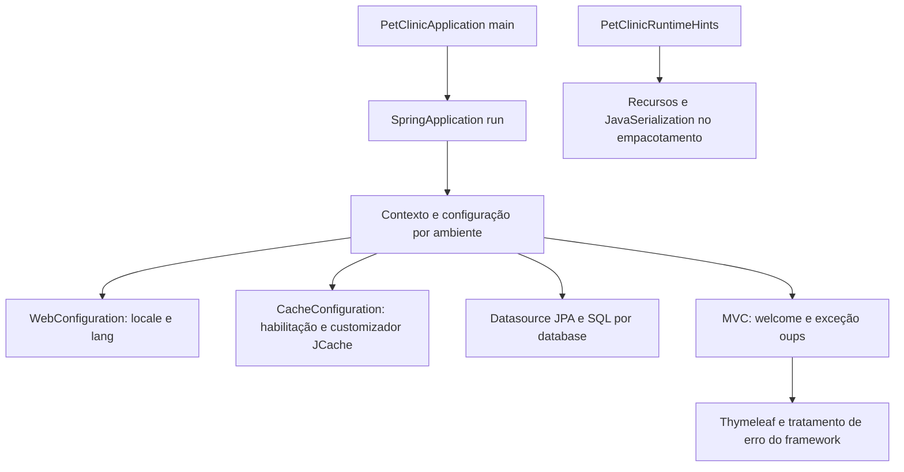

# Sistema — Design Técnico

## Validação do usuário — escopo de destino

🟢 Decisões confirmadas pelo usuário, sem alteração do legado. Este bloco define a intenção de destino; seções de código/testes abaixo são o retrato extraído. Pendências de produto já respondidas não devem ser reabertas por textos históricos; apenas os residuais continuam em aberto.

- 🟢 **D-01:** Visita sempre deve conter data futura. Requisito desejado confirmado; rejeitar data null/vazia e hoje/passado no destino. Padrão amanhã pode continuar na abertura, sem dispensar validação. Omissão que mantém o default não comprova confirmação explícita de data pelo usuário.
- 🟢 **D-02:** Manter somente PostgreSQL. Escopo de banco do destino é PostgreSQL; H2/MySQL permanecem evidência histórica, não obrigação futura. Preservar a regra extraída de unicidade por responsável sem assumir necessidade de equivalência MySQL.
- 🟢 **D-03:** Sistema somente em rede local. Contexto de uso em rede local informado pelo usuário. Não inferir autenticação, papéis, ausência de ameaças ou configuração real de ACL/proxy. Aplicar contexto às operações de todas as units.
- 🟢 **D-05:** São Paulo, Brasil. Adotar America/Sao_Paulo como identificador técnico correspondente ao local informado. Não usar offset UTC fixo nem inferir que JVM atual já está nesse fuso.
- 🟢 **D-04:** Não há política de cache. Confirmada ausência de política operacional a preservar. Não significa remover cache nem definir TTL=0; manter declaração atual e escolher política em evolução se necessária.
- 🟢 **VET-INV-01:** Não é necessário preservar dados. Dispensada migração/preservação de dados históricos no destino. Tarefas de migração de domínio deixam de ser obrigatórias; permite planejamento de instalação nova, sem autorização de exclusão de base existente.
- 🟢 **SIS-D-02:** Português e inglês. Idiomas requeridos do destino: português e inglês. Outros bundles do legado não são obrigatórios por esta resposta; não removidos. Default inglês do código fica como referência atual, sem escolha nova de default.
- 🟢 **SIS-D-03:** Página genérica de erro sem expor informações. Requisito desejado confirmado: página genérica sem detalhes internos de exceção/configuração. Override ALWAYS e mensagem demonstrativa dos testes são históricos, não alvo de implantação.
- 🟢 **SIS-D-04:** Kubernetes; Docker local se possível. Destino prioritário é Kubernetes. Docker para desenvolvimento local é preferência condicional a viabilidade, não promessa de ambiente pronto ou deploy autorizado.

🔴 Refinamentos e evidência técnica não executada: ver [registro de decisões](../validated-decisions.md) e [lacunas finais](../gaps.md). Nenhum requisito novo foi implementado.

🟢 CONFIRMADO — Design do pacote system, da inicialização no pacote raiz e das propriedades compartilhadas. Cobre SIS-RF-01 a SIS-RF-06 de [requirements.md](requirements.md). Artefato estático: não se iniciou servidor, banco ou cluster; configuração declarada e comportamento observado em runtime permanecem distintos.

## Interface

### HTTP e views

| Entrada | Método/símbolo | Saída declarada | Evidência / limite |
|---|---|---|---|
| 🟢 GET / | WelcomeController.welcome() | String welcome | WelcomeControllerTests espera 200/view; teste não executado |
| 🟢 GET /oups | CrashController.triggerException() | Lança RuntimeException, embora retorno declarado seja String | Teste unitário espera mensagem demonstrativa; integração espera 500 no contexto específico |
| 🟢 lang em requisição MVC | LocaleChangeInterceptor registrado | Atualiza preferência via LocaleResolver de sessão | Não é endpoint próprio; locale inválido/fallback não caracterizados |
| 🟢 Tratamento de erro framework | templates/error.html | HTML com texto por status e message do contexto | Não há controller próprio @GetMapping(/error) nesses arquivos |

🟢 CONFIRMADO — Controllers não retornam ResponseEntity nem definem ResponseStatus. GET /oups sempre lança a mensagem “Expected: controller used to showcase what happens when an exception is thrown”. A seleção de HTML/JSON de erro pertence à infraestrutura Spring Boot, não ao retorno String do método. Não presumir conteúdo de erro de produção com base no override de teste.

### Beans e inicialização

| Símbolo | Entrada | Retorno / efeito |
|---|---|---|
| 🟢 WebConfiguration.localeResolver | nenhum | LocaleResolver: SessionLocaleResolver padrão inglês |
| 🟢 WebConfiguration.localeChangeInterceptor | nenhum | LocaleChangeInterceptor com parâmetro lang |
| 🟢 WebConfiguration.addInterceptors | InterceptorRegistry | void; registra localeChangeInterceptor |
| 🟢 CacheConfiguration.petclinicCacheConfigurationCustomizer | nenhum | JCacheManagerCustomizer que chama createCache("vets", configuração) |
| 🟢 CacheConfiguration.cacheConfiguration | nenhum | Configuration<Object,Object> com MutableConfiguration e statisticsEnabled=true |
| 🟢 PetClinicApplication.main | String[] args | void; SpringApplication.run(PetClinicApplication.class,args) |
| 🟢 PetClinicRuntimeHints.registerHints | RuntimeHints hints, ClassLoader classLoader | void; registra recursos/serialização; classLoader não usado no corpo |

## Fluxo Principal

### 1. Bootstrap e hints — SIS-RF-05

1. 🟢 PetClinicApplication é SpringBootApplication e importa PetClinicRuntimeHints via ImportRuntimeHints.
2. 🟢 main delega os argumentos a SpringApplication.run; montagem de contexto, autoconfiguração e erros de startup ficam no framework.
3. 🟢 RuntimeHints registra padrões db/* e db/*/*, messages/* e mysql-default-conf.
4. 🟢 Registra withJavaSerialization(true) para BaseEntity, Person e Vet. Não registra NamedEntity explicitamente nesse conjunto; ausência explícita não prova falha nativa.

🟢 CONFIRMADO — Fontes: PetClinicApplication.java e PetClinicRuntimeHints.java. 🔴 SIS-INV-04 — Declaração de hints não comprova presença de todo recurso no artefato final nem build nativo aprovado.

### 2. Boas-vindas e erro — SIS-RF-01 e SIS-RF-02

1. 🟢 WelcomeController atende / e retorna welcome; Thymeleaf resolve templates/welcome.html e layout compartilhado.
2. 🟢 CrashController atende /oups e lança RuntimeException; não captura nem retorna view diretamente.
3. 🟢 error.html usa fragments/layout, imagem de recurso, chave somethingHappened e switch de status: 404→error.404, 500→error.500, demais→error.general. Um parágrafo apresenta message do contexto.
4. 🟢 CrashControllerIntegrationTests configura spring.web.error.include-message=ALWAYS e management.endpoints.access.default=none, desabilitando autoconfiguração de datasource/JPA na TestConfiguration. Seus cenários esperam 500 JSON com timestamp/status/error/message/path e 500 HTML contendo mensagem sem Whitelabel.

🟢 CONFIRMADO — Asserções são expectativas do teste, não execução desta extração. 🔴 SIS-D-03 — Disponibilidade/ocultação de message em implantação e política de exposição de erro exigem validação; não copiar ALWAYS de teste para produção como requisito observado.

### 3. Idioma — SIS-RF-03

1. 🟢 localeResolver cria SessionLocaleResolver e aplica Locale.ENGLISH como default.
2. 🟢 localeChangeInterceptor cria o interceptor e configura paramName=lang; addInterceptors o registra.
3. 🟢 spring.messages.basename=messages/messages aponta aos bundles em resources/messages.
4. 🟡 INFERIDO — O fluxo esperado é preferência de locale mantida por sessão e usada nas views. Configuração sustenta a intenção; persistência de sessão, fallback de idioma/chaves e respostas inválidas não foram executados.

🟢 CONFIRMADO — I18nPropertiesSyncTest pesquisa arquivos Java/HTML mas aplica regras de texto literal no ramo HTML; compara chaves dos bundles com o base e ignora messages_en por fallback segundo comentário. Não verifica qualidade semântica da tradução nem toda troca de idioma no navegador. Não há allowlist própria de idiomas em WebConfiguration.

### 4. Cache de dados — SIS-RF-04

1. 🟢 CacheConfiguration usa Configuration(proxyBeanMethods=false) e EnableCaching.
2. 🟢 Bean retornado é customizador JCache; quando aplicado, chama cm.createCache("vets",cacheConfiguration()).
3. 🟢 cacheConfiguration devolve MutableConfiguration com estatísticas true. Não define tamanho, TTL, eviction ou handler de falha.
4. 🟢 VetRepository anota as consultas completa/paginada com Cacheable("vets"). A seleção de CacheManager pertence à autoconfiguração/dependências.

🔴 D-04 — Caffeine é dependência runtime, mas customizador JCache não prova provedor efetivo. Não afirmar que createCache foi executado, que JMX está acessível ou que existe invalidação. Cache HTTP de recursos estáticos é configuração independente.

### 5. Configuração e perfis — SIS-RF-06

| Chave / grupo | Valor declarado / origem |
|---|---|
| 🟢 database | h2 em application.properties; mysql ou postgres no perfil |
| 🟢 spring.sql.init.schema-locations | classpath*:db/${database}/schema.sql |
| 🟢 spring.sql.init.data-locations | classpath*:db/${database}/data.sql |
| 🟢 spring.sql.init.mode | always nos dois perfis externos |
| 🟢 spring.jpa.hibernate.ddl-auto | none |
| 🟢 spring.jpa.open-in-view | false |
| 🟢 naming.physical-strategy | org.hibernate.boot.model.naming.PhysicalNamingStrategySnakeCaseImpl |
| 🟢 spring.jpa.properties.hibernate.default_batch_fetch_size | 16 |
| 🟢 spring.thymeleaf.mode | HTML |
| 🟢 spring.messages.basename | messages/messages |
| 🟢 management.endpoints.web.exposure.include | *; comentário delimita intenção de desenvolvimento/teste |
| 🟢 logging.level.org.springframework | INFO; DEBUG/TRACE estão comentados |
| 🟢 spring.web.resources.cache.cachecontrol.max-age | 12h |

🟢 CONFIRMADO — Perfil MySQL usa MYSQL_URL com default jdbc:mysql://localhost/petclinic e MYSQL_USER/MYSQL_PASS; PostgreSQL usa POSTGRES_URL com default jdbc:postgresql://localhost/petclinic e POSTGRES_USER/POSTGRES_PASS. Defaults de usuário/senha de demonstração estão nos arquivos. Não foram lidos segredos de ambiente para inferir credenciais implantadas.

🟢 CONFIRMADO — DDL/data são SQL próprios, não migrations incrementais confirmadas. Schema H2 contém DROP TABLE; arquivos externos usam CREATE IF NOT EXISTS e seeds devem ser avaliados no contexto. Não executar inicialização contra dados existentes como parte desta documentação.

🟢 CONFIRMADO — Diagrama resume responsabilidades declaradas, não ordem completa de callbacks do framework ou confirmação de ativação do provedor JCache.

## Fluxos Alternativos

| Condição | Código local | Evidência pendente |
|---|---|---|
| 🟢 Locale inválido / chave faltante | Sem tratamento específico em WebConfiguration | 🔴 SIS-INV-02: status/fallback/sessão |
| 🟢 Cache já existente / falha de criação | Customizador chama createCache sem catch | 🔴 SIS-INV-03: aplicação do customizador e erro concreto |
| 🟢 Banco indisponível / credencial inválida | Datasource delegado ao framework | 🔴 SIS-INV-05: startup e política efetiva |
| 🟢 Recurso/hint ausente no artefato | Registro de padrões, sem verificação própria | 🔴 SIS-INV-04: validar build/runtime quando necessário |
| 🟢 View welcome não resolvida | welcome retorna nome da view sem fallback | 🔴 SIS-INV-01: resposta de renderização |
| 🟢 Mensagem de erro oculta | Template depende de atributo do contexto | 🔴 SIS-D-03: configuração efetiva de implantação |

## Dependências

- 🟢 Spring Boot/MVC/Thymeleaf e infraestrutura de autoconfiguração, conforme pom.xml/build.gradle.
- 🟢 Java Locale, SessionLocaleResolver, LocaleChangeInterceptor e bundles de mensagem.
- 🟢 Abstração Spring Cache/JCache, configuração MutableConfiguration e repository vet consumidor; Caffeine declarado runtime.
- 🟢 BaseEntity/Person/Vet para hints; unidade sistema referencia essas classes sem ser proprietária dos dados de domínio.
- 🟢 SQL por perfil, recursos estáticos e layout compartilhado com responsáveis/veterinários.
- 🟢 Contexto operacional em k8s/*.yml e docker-compose.yml: Compose declara bancos, Kubernetes usa imagem dsyer/petclinic e PostgreSQL. 🔴 SIS-D-04 — Correspondência da imagem ao checkout/service binding não comprovada.

## Decisões de Design Identificadas

| Decisão observada | Evidência | Confiança |
|---|---|---|
| Idioma por sessão, inglês padrão | WebConfiguration | 🟢 CONFIRMADO; não é sessão de autenticação |
| Exceção de demonstração separada | CrashController e testes | 🟢 CONFIRMADO |
| Cache por abstração com customizador condicional à infraestrutura | CacheConfiguration/VetRepository | 🟢 declarações; 🔴 ativação efetiva |
| SQL por database/perfil e sem geração JPA de schema | application*.properties | 🟢 CONFIRMADO |
| Hints específicos de recursos/serialização | PetClinicRuntimeHints | 🟢 CONFIRMADO; execução nativa pendente |

## Estado Interno

🟢 CONFIRMADO — Não há entidade JPA de negócio própria em system. Estado é de infraestrutura: preferência de locale em sessão conforme resolver, beans de configuração, propriedades resolvidas e caches no provedor efetivo. Controllers mantêm apenas métodos simples, sem campos de estado de usuário no código lido.

🔴 D-04 — Conteúdo, escopo de memória, política de tamanho e ciclo de vida do cache dependem do runtime. Não confundir preferência de sessão com login nem estatísticas declaradas com audit trail persistente.

## Observabilidade

🟢 CONFIRMADO — Logging Spring INFO e seleção ampla Actuator são propriedades globais. Cache mutable declara estatísticas, destinadas ao mecanismo JCache conforme comentário. Nenhum logger/evento de negócio próprio foi encontrado nessas classes. Rota /oups é ferramenta demonstrativa de erro, não health check.

🟢 CONFIRMADO — Probes /livez e /readyz constam no manifesto com configuração adicional de health via SPRING_APPLICATION_JSON. Não são handlers próprios de system nem foram chamados. [deployment.md](../deployment.md) documenta os manifests.

## Riscos e Lacunas

- 🔴 D-03 / SIS-D-01: controle de acesso efetivo a páginas, /oups, Actuator e probes; exposure.include não prova disponibilidade/segurança de cada endpoint.
- 🔴 D-04: cache ativo, limites, expiração, invalidação e estatísticas efetivas.
- 🔴 SIS-D-02: idiomas/fallback e locale inválido; teste de sincronismo não garante tradução nem sessão.
- 🔴 SIS-D-03: conteúdo de erro em runtime; contexto dos testes tem overrides que não devem ser promovidos a defaults de produção.
- 🔴 SIS-D-04: imagem remota versus checkout, bindings de banco e probes não validados em cluster.
- 🔴 SIS-INV-01–05: falhas de renderização, idioma, cache, startup e banco exigem caracterização contextual.

## Rastreabilidade

🟢 CONFIRMADO — SIS-RF-01 e SIS-RF-02 → fluxo 2, SIS-CA-01–04; SIS-RF-03 → fluxo 3, SIS-CA-05/06; SIS-RF-04 → fluxo 4, SIS-CA-07; SIS-RF-05 → fluxo 1, SIS-CA-08/09; SIS-RF-06 → fluxo 5, SIS-CA-10/11. Fontes completas estão em requirements.md.

🟢 CONFIRMADO — Ver [análise técnica](../code-analysis.md), [arquitetura](../architecture.md), [fluxo sistema](../flowcharts/system.md) e [deployment](../deployment.md). Os fluxos estão consolidados aqui; o plano atual não exige flows.md adicional.
