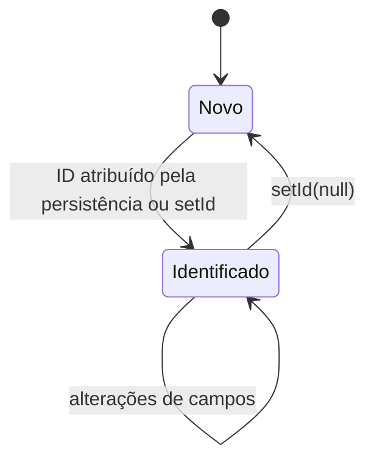
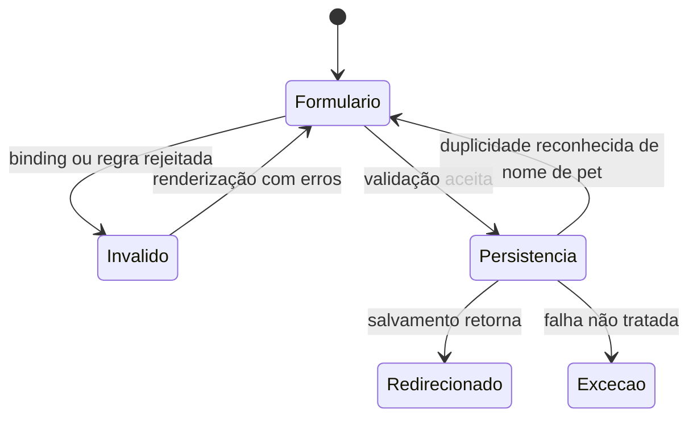

# Estados e transições

🟢 CONFIRMADO — Não existem campos status/estado nem enums de ciclo de atendimento em Owner, Pet, Visit ou Vet. Não foi inferida máquina de agendado/concluído/cancelado. A propriedade isNew de BaseEntity é um estado técnico, calculado por id == null.

## Identidade técnica

🟢 CONFIRMADO — setId é público, sem restrições; portanto o diagrama descreve o objeto em memória, não um workflow transacional garantido. Fonte: model/BaseEntity.java. Bindings HTTP bloqueiam id, reduzindo a superfície de alteração por formulário.

## Submissão de formulários

🟢 CONFIRMADO — Fluxo operacional dos controllers; não é campo de status persistido. GET de visita já adiciona um objeto novo ao agregado em memória, sem salvar. A ausência de exclusão/edição de visita no controller não comprova política de negócio proibindo essas ações.
