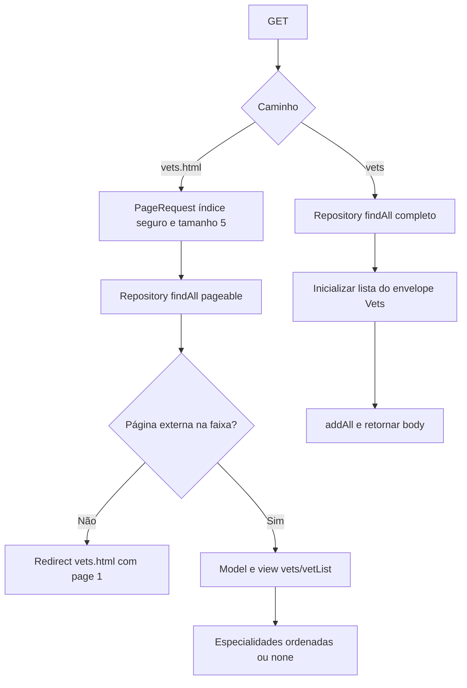

# Veterinários — Design Técnico

## Validação do usuário — escopo de destino

🟢 Decisões confirmadas pelo usuário, sem alteração do legado. Este bloco define a intenção de destino; seções de código/testes abaixo são o retrato extraído. Pendências de produto já respondidas não devem ser reabertas por textos históricos; apenas os residuais continuam em aberto.

- 🟢 **D-02:** Manter somente PostgreSQL. Escopo de banco do destino é PostgreSQL; H2/MySQL permanecem evidência histórica, não obrigação futura. Preservar a regra extraída de unicidade por responsável sem assumir necessidade de equivalência MySQL.
- 🟢 **D-03:** Sistema somente em rede local. Contexto de uso em rede local informado pelo usuário. Não inferir autenticação, papéis, ausência de ameaças ou configuração real de ACL/proxy. Aplicar contexto às operações de todas as units.
- 🟢 **D-04:** Não há política de cache. Confirmada ausência de política operacional a preservar. Não significa remover cache nem definir TTL=0; manter declaração atual e escolher política em evolução se necessária.
- 🟢 **VET-D-01:** Somente a aplicação consome; campos desnecessários podem ser removidos numa refatoração. Não há consumidor externo informado. Simplificação de campos é permitida no planejamento de refatoração após verificar uso; nenhum campo concreto foi declarado desnecessário nem removido.
- 🟢 **VET-D-02:** Não há contrato de erro definido. Não há contrato conhecido a preservar para falhas da consulta; não atribuir status novo como comportamento do legado.
- 🟢 **VET-D-03:** Ordem alfabética. Ordenação alfabética passa a ser requisito desejado confirmado para veterinários; é diferença em relação a findAll/PageRequest sem Sort explícito no legado.
- 🟢 **VET-INV-01:** Não é necessário preservar dados. Dispensada migração/preservação de dados históricos no destino. Tarefas de migração de domínio deixam de ser obrigatórias; permite planejamento de instalação nova, sem autorização de exclusão de base existente.
- 🟢 **SIS-D-02:** Português e inglês. Idiomas requeridos do destino: português e inglês. Outros bundles do legado não são obrigatórios por esta resposta; não removidos. Default inglês do código fica como referência atual, sem escolha nova de default.
- 🟢 **SIS-D-03:** Página genérica de erro sem expor informações. Requisito desejado confirmado: página genérica sem detalhes internos de exceção/configuração. Override ALWAYS e mensagem demonstrativa dos testes são históricos, não alvo de implantação.

🔴 Refinamentos e evidência técnica não executada: ver [registro de decisões](../validated-decisions.md) e [lacunas finais](../gaps.md). Nenhum requisito novo foi implementado.

🟢 CONFIRMADO — Unit vet, documentada em português como veterinarios. Este design cobre VET-RF-01 a VET-RF-04 de [requirements.md](requirements.md), usando fontes Java, template, schemas e testes. Não houve execução de aplicação ou suite; comportamento operacional não observado permanece explícito como lacuna.

## Interface

### HTTP

| Método | Caminho | Entrada | Retorno do handler | Status / evidência |
|---|---|---|---|---|
| 🟢 GET | /vets.html | page:int com @RequestParam(defaultValue="1") | String vets/vetList ou redirect:/vets.html com atributo page=1 | 🟢 Teste MVC declara expectativa 200 para página válida e 3xx para fora de faixa; execução pendente |
| 🟢 GET | /vets | Nenhum parâmetro do handler | @ResponseBody Vets contendo todos os resultados de findAll() | 🟢 Teste MVC com Accept application/json espera 200, application/json e $.vetList[0].id=1; execução pendente |

🟢 CONFIRMADO — Fontes: VetController.showVetList/showResourcesVetList e VetControllerTests. Mappings não declaram produces/consumes; page não é parâmetro do método de dados. Não há handler específico para consulta por ID, cadastro/edição/exclusão, busca por nome ou filtro de especialidade.

🔴 VET-D-01/02 — Shape completo serializado, suporte XML, negociação de Accept e respostas de erro não foram capturados. Anotações JAXB e comentário de classe não bastam para prometer XML. Não transformar DataAccessException em status HTTP de contrato presumido.

### Componentes e assinaturas

| Símbolo | Parâmetros | Retorno | Comportamento |
|---|---|---|---|
| 🟢 VetController.showVetList | int page, Model model, RedirectAttributes redirectAttributes | String | Consulta, valida faixa e monta model ou redirect |
| 🟢 VetController.findPaginated | int page | Page<Vet> | PageRequest com índice max(page,1)-1 e tamanho 5 |
| 🟢 VetController.addPaginationModel | int page, Page<Vet> paginated, Model model | String | Preenche quatro atributos e retorna view |
| 🟢 VetController.showResourcesVetList | nenhum | Vets | Novo envelope e addAll(findAll()) |
| 🟢 VetRepository.findAll | nenhum | Collection<Vet> | readOnly, Cacheable("vets"), throws DataAccessException |
| 🟢 VetRepository.findAll | Pageable pageable | Page<Vet> | readOnly, mesmo nome de cache, throws DataAccessException |
| 🟢 Vet.getSpecialtiesInternal | nenhum | Set<Specialty> | Inicializa HashSet se null; acesso protected |
| 🟢 Vet.getSpecialties | nenhum | List<Specialty> | Nova lista ordenada por NamedEntity.getName |
| 🟢 Vet.getNrOfSpecialties | nenhum | int | Tamanho do conjunto interno |
| 🟢 Vet.addSpecialty | Specialty specialty | void | Set.add, sem checagem local de null |
| 🟢 Vets.getVetList | nenhum | List<Vet> | Inicializa ArrayList se null e expõe lista mutável |

🟢 CONFIRMADO — VetRepository estende Repository<Vet,Integer>, sem herdar/expor save ou delete na interface local. Fontes: VetController.java, VetRepository.java, Vet.java e Vets.java no pacote src/main/java/org/springframework/samples/petclinic/vet/.

## Fluxo Principal

### 1. Lista HTML — VET-RF-01

1. 🟢 MVC vincula page ao inteiro do handler, com padrão 1. O controller não impõe máximo explícito antes da consulta (VetController.showVetList).
2. 🟢 findPaginated calcula safePage=max(page,1) e PageRequest.of(safePage-1,5). Não fornece Sort; não inferir ordem por sobrenome ou ID (VetController.findPaginated).
3. 🟢 vetRepository.findAll(pageable) retorna Page<Vet>; as anotações de transação/cache pertencem ao repository. Não há camada service própria entre essa chamada e o controller.
4. 🟢 Após retorno, showVetList verifica page < 1 ou page > max(totalPages,1). Em faixa válida chama addPaginationModel.
5. 🟢 Model recebe currentPage:int, totalPages:int, totalItems:long e listVets:List<Vet>, usando getContent/getTotalPages/getTotalElements. Retorna vets/vetList.
6. 🟢 Template exibe firstName + espaço + lastName, percorre getSpecialties e mostra cada nome; quando getNrOfSpecialties == 0, exibe mensagem localizada none. Navegação aparece apenas quando totalPages > 1; links usam /vets.html?page=... (templates/vets/vetList.html).

### 2. Faixa inválida — VET-RF-02

1. 🟢 A consulta já ocorreu, mesmo para página zero/negativa. Índice interno seguro não torna válida a página externa original.
2. 🟢 Se faixa inválida, adiciona atributo de redirect page=1 e retorna redirect:/vets.html.
3. 🟢 Em base vazia, totalPages=0: página externa 1 é válida pela comparação com max(0,1); retorna lista vazia. Página 2 redireciona. Não existe erro notFound de catálogo nesse controller.

🟢 CONFIRMADO — Fonte: VetController.showVetList/findPaginated. 🔴 Falha do banco/cache durante a consulta pode interromper antes do redirect; não garantir correção de faixa independentemente da infraestrutura.

### 3. Lista completa de dados — VET-RF-03

1. 🟢 showResourcesVetList cria new Vets.
2. 🟢 Chama vetRepository.findAll() sem Pageable.
3. 🟢 getVetList inicializa ArrayList; addAll copia referências da coleção retornada para a lista do envelope.
4. 🟢 Retorna envelope com @ResponseBody, delegando conversão de representação ao framework. Coleção vazia gera lista inicializada vazia; não há branch de 404 ou null no handler.

🟢 CONFIRMADO — Fontes: VetController.showResourcesVetList e Vets.getVetList. Não há limite de itens nem paginação no método, e nenhum parâmetro page lido por ele. 🔴 Um retorno null inesperado de implementação externa de repository não é tratado localmente e não foi caracterizado; não é contrato normal de coleção vazia.

### 4. Especialidades — VET-RF-04

1. 🟢 Vet armazena Set<Specialty> inicialmente null. getSpecialtiesInternal o substitui por HashSet vazio sob demanda.
2. 🟢 addSpecialty usa Set.add. Não há equals/hashCode por identidade de negócio nas superclasses lidas; duas instâncias com mesmo ID/nome não são explicitamente deduplicadas por regra própria.
3. 🟢 getSpecialties executa stream, sorted(Comparator.comparing(NamedEntity::getName)) e collect(toList). Retorna lista nova, sem ordenar em posição o conjunto. A comparação não usa Collator/Locale nem tratamento de null declarado.
4. 🟢 getNrOfSpecialties mede o conjunto interno; é usado pelo template para none.

🟡 INFERIDO — Ordenar s itens tem custo O(s log s), sujeito à implementação; não é SLA medido. 🔴 VET-INV-01 — Dados null podem falhar durante comparação/renderização, dependendo do conteúdo efetivamente percorrido; caracterizar antes de definir tolerância.

🟢 CONFIRMADO — Diagrama resume ramos do controller. Cache/transação e conversão HTTP são infraestrutura em torno das consultas, sem validação de runtime nesta etapa.

## Fluxos Alternativos

| Condição | Resposta local observada | Limite |
|---|---|---|
| 🟢 Page 0/negativa | Consulta índice 0; depois redirect page=1 | Não há captura local de falha da consulta |
| 🟢 Page maior que total | Consulta página solicitada; depois redirect page=1 | Não se limita a consulta ao total previamente |
| 🟢 Catálogo vazio | HTML retorna view com lista vazia; body retorna envelope com lista vazia | Não há mensagem especial de ausência de catálogo no controller |
| 🟢 Vet sem especialidades | Lista/quantidade vazias e none no template | Diferente de elemento Specialty null |
| 🟢 DataAccessException | Nenhum catch no handler | 🔴 Status/conteúdo HTTP final não demonstrados |
| 🟢 Parâmetro não convertível para int | Conversão delegada ao MVC, sem política local | 🔴 VET-D-02: resposta precisa ser caracterizada |
| 🟢 Specialty null/nome null | Ausência de guardas no add/comparador | 🔴 VET-INV-01: efeito depende de comparação e renderização |

## Dependências

- 🟢 **modelo:** Person/BaseEntity para Vet e NamedEntity/BaseEntity para Specialty; mapeiam identidade e campos herdados. Restrições de validação herdadas não implicam submissão @Valid em GET.
- 🟢 **Spring Data JPA e banco por perfil:** Repository, Page/Pageable e entidades com ManyToMany. Schemas H2/MySQL/PostgreSQL definem vets, specialties e vet_specialties.
- 🟢 **sistema/cache:** VetRepository anota ambas as consultas com vets. CacheConfiguration habilita caching e retorna JCacheManagerCustomizer que cria vets com MutableConfiguration e estatísticas. Isso não demonstra que o provedor ativo é JCache; Caffeine também consta como dependência runtime.
- 🟢 **MVC/conversão:** @Controller, @RequestParam e @ResponseBody. Vets tem XmlRootElement e seu getter tem XmlElement, assim como Vet.getSpecialties; suporte negociado em execução é lacuna.
- 🟢 **Thymeleaf/i18n:** template vets/vetList usa layout compartilhado e mensagens vets/name/specialties/none/pages. Idioma é configuração transversal de system.
- 🟢 **Sem vínculo de chamada com owner:** Visit não referencia Vet e nenhum handler vet seleciona animal/visita. Catálogos compartilham infraestrutura/banco, não uma chamada de negócio direta.

## Decisões de Design Identificadas

| Decisão observada | Evidência | Confiança |
|---|---|---|
| Separar HTML paginado de body completo | Dois handlers e duas assinaturas findAll | 🟢 CONFIRMADO |
| Envelope Vets em vez de coleção direta | showResourcesVetList e comentário no método | 🟢 CONFIRMADO; representação final completa pendente |
| Reutilizar nome vets nas duas consultas de cache | Duas anotações Cacheable | 🟢 CONFIRMADO; chaves/entradas efetivas dependem da infraestrutura |
| Transações de leitura | Transactional(readOnly=true) no repository | 🟢 CONFIRMADO quanto à declaração; não é proibição SQL absoluta comprovada |
| Lista ordenada de especialidades derivada de Set | getSpecialties e HashSet interno | 🟢 CONFIRMADO |
| Página segura na consulta e validação externa posterior | findPaginated e showVetList | 🟢 CONFIRMADO; ADR 003 transversal |

## Estado Interno

| Estrutura | Estado e persistência |
|---|---|
| 🟢 Vet | Entidade vets, id Integer herdado; firstName/lastName herdados de Person; specialties em Set, null até inicialização/carregamento |
| 🟢 Specialty | Entidade specialties com id e name herdados; sem campo próprio adicional |
| 🟢 vet_specialties | Tabela de junção com vet_id e specialty_id; não é entidade Java independente |
| 🟢 Vets | Envelope sem tabela; List<Vet> inicializada sob demanda e mutável |
| 🟢 Model HTML | currentPage, totalPages, totalItems, listVets transitórios por atendimento |
| 🔴 Cache ativo | Nome declarado vets; provedor, TTL, capacidade, atualização e estatísticas efetivas não confirmados |

🟢 CONFIRMADO — ManyToMany é EAGER, sem cascade declarado em Vet. MySQL/PostgreSQL declaram UNIQUE do par vet_id/specialty_id; schema H2 não declara essa unicidade. Dados seed são exemplos, não enum fechado de especialidades. @MappedSuperclass de modelo não cria tabelas próprias. Fontes: Vet.java, Specialty.java, Vets.java e schemas em src/main/resources/db/.

## Observabilidade

🟢 CONFIRMADO — Não há logger, flash de sucesso/erro ou emissão própria de evento de domínio nos handlers vet. CacheConfiguration habilita estatísticas na configuração JCache construída; acesso efetivo a métricas/JMX depende do provedor ativo. application.properties fornece logging org.springframework=INFO e configuração de Actuator global.

🔴 D-04 — Não se mediu hit/miss, número de consultas, invalidação, consumo de memória ou frescor de catálogo. Não atribuir TTL ou garantia de cache distribuído à anotação Cacheable.

## Riscos e Lacunas

- 🔴 **D-04:** identificar CacheManager, limites, expiração e invalidação após mudanças externas, mantendo evidência de runtime distinta da declaração de configuração.
- 🔴 **VET-D-01:** caracterizar payload completo, JSON/XML e negociação. Teste JSON afirma um ID, não todos os campos ou formatos.
- 🔴 **VET-D-02:** caracterizar page inválido por conversão/overflow e respostas de falhas de repository/cache sem inventar status de negócio.
- 🔴 **VET-D-03:** confirmar ordem desejada de veterinários; não há Sort declarado e ordem de especialidades não estabelece ordem dos veterinários.
- 🔴 **VET-INV-01:** definir comportamento para dados inconsistentes somente após caracterização e decisão; não inserir silenciosamente filtragem de null.
- 🔴 **D-03:** proteção de acesso externa desconhecida; nenhum papel implementado nesses métodos.
- 🟡 **Volume:** body completo e EAGER podem aumentar custo conforme catálogo; não há medição ou SLA que autorize impor limites novos nesta extração.

## Rastreabilidade e critérios relacionados

🟢 CONFIRMADO — VET-RF-01 → fluxo 1 e VET-CA-01/02/03; VET-RF-02 → fluxo 2 e VET-CA-04/05; VET-RF-03 → fluxo 3 e VET-CA-06/07/08; VET-RF-04 → fluxo 4 e VET-CA-09/10. Dados inválidos de especialidades ficam na investigação VET-INV-01.

🟢 CONFIRMADO — Fontes principais: src/main/java/org/springframework/samples/petclinic/vet/VetController.java, VetRepository.java, Vet.java, Specialty.java e Vets.java. Template: src/main/resources/templates/vets/vetList.html. Infraestrutura: src/main/java/org/springframework/samples/petclinic/system/CacheConfiguration.java, pom.xml, build.gradle e application.properties.

🟢 CONFIRMADO — VetControllerTests contém três métodos @Test com repository mockado; VetTests.serialization verifica serialização Java de id/firstName/lastName sem especialidades configuradas. ClinicServiceTests.shouldFindVets espera Douglas com dentistry/surgery em ordem; nenhuma dessas expectativas foi executada aqui. Serialização Java não prova contrato JSON/XML completo.

🟢 CONFIRMADO — Ver [análise técnica](../code-analysis.md), [dicionário de dados](../data-dictionary.md), [ERD](../erd-complete.md), [fluxo vet](../flowcharts/vet.md) e matriz V01–V11 em requirements.md. Os quatro fluxos estão cobertos neste design; não é necessário arquivo flows.md adicional no plano atual.
